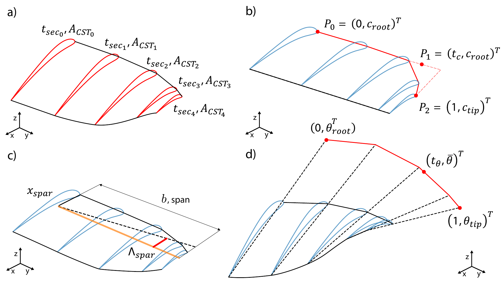
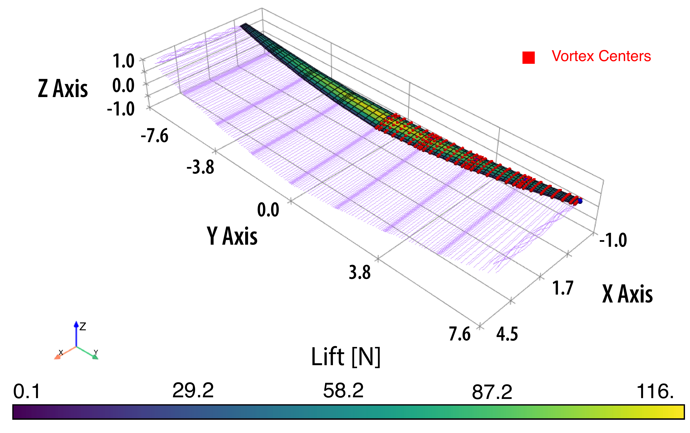
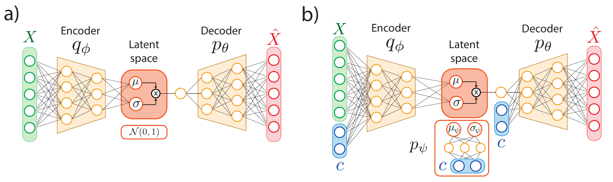
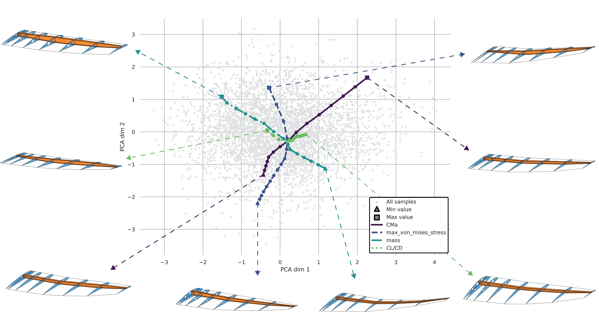
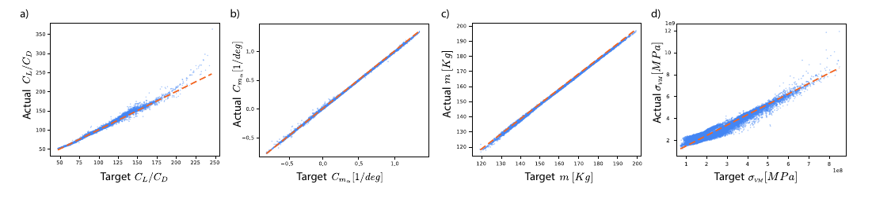
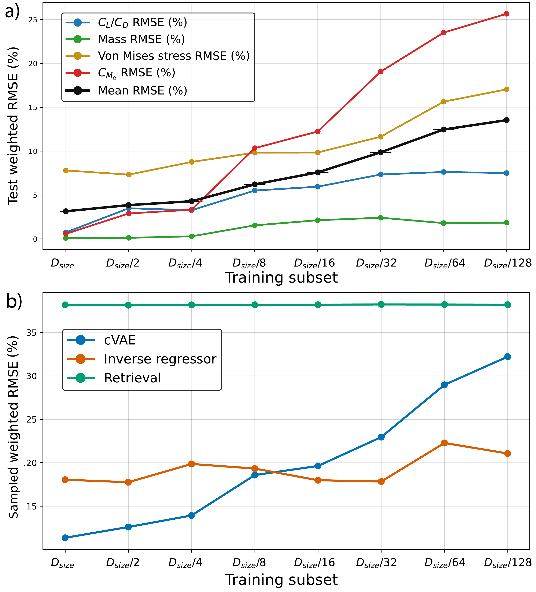

# Inverse Aeroelastic Design of Glider Wings

<p align="center">
  <strong>Aeroelastic cVAE Research Release</strong><br>
  Engineering Design and Computing Laboratory, ETH Zurich<br>
  Maintained by <a href="mailto:lmiele@ethz.ch">Lorenzo Miele</a>, and <a href="mailto:jpfenniger@ethz.ch">Jona Pfenniger</a>.<br>
  Jona and Lorenzo are the primary contributors to this release.
</p>

<p align="center">
  
  
  
  
</p>

This repository is a reproducible research release for learning and generating aeroelastic glider-wing designs with conditional variational autoencoders.

Flexible-wing design is a coupled problem because planform, sectional airfoils, structural stiffness, aerodynamic loading, mass, stress, and deformation influence one another.

The workflow evaluates parameterized wings with coupled vortex-lattice aerodynamics and Euler-Bernoulli beam mechanics, then learns the resulting design space with airfoil, wing, and conditional wing VAEs.

The accompanying article is currently under review and will be made available upon acceptance.

<p align="center">
  
</p>

<p align="center"><em>From parameterized wing geometry and coupled simulation to learned latent representations and conditional wing generation.</em></p>

## ✈️ Wing representation and physics

Each wing is represented by planform, twist, spar sweep, and sectional airfoil parameters.

The global parameter blocks are

$$
\mathbf{p}_{\mathrm{planform}} = [c_{\mathrm{tip}}, t_c, w_c]^\mathsf{T},
\qquad
\mathbf{p}_{\mathrm{twist}} = [\theta_{\mathrm{root}}, \theta_{\mathrm{tip}}, t_\theta]^\mathsf{T},
\qquad
\mathbf{p}_{\mathrm{sweep}} = [\Lambda_{\mathrm{spar}}].
$$

Here, $c_{\mathrm{tip}}$ is the tip chord, $t_c$ and $w_c$ control the rational quadratic Bézier chord law, $\theta_{\mathrm{root}}$ and $\theta_{\mathrm{tip}}$ set the spanwise twist, $t_\theta$ locates the twist transition, and $\Lambda_{\mathrm{spar}}$ is the spar sweep angle.

At five spanwise stations, airfoil geometry is represented by upper and lower CST coefficients $A_i^u$ and $A_i^\ell$, together with the leading-edge coefficient $A_{\mathrm{le}}$.

The complete generated wing vector is

$$
\mathbf{p} = [\mathbf{p}_{\mathrm{planform}}, \mathbf{p}_{\mathrm{twist}}, \mathbf{p}_{\mathrm{sweep}}, \mathbf{p}_{\mathrm{airfoil}}]^\mathsf{T}.
$$

The coupled solver computes the deformed wing response rather than treating aerodynamic and structural models independently.

The paired figures below connect the two sides of the problem.

The left panel shows the low-dimensional description supplied to the generator.

It locates the planform control points, spar line, twist distribution, and spanwise airfoil stations that define an undeformed candidate wing.

The right panel shows the physics evaluated for that candidate.

Aerodynamic loading from the vortex-lattice model is transferred to the beam model, which captures deflection and the resulting change in the aeroelastic state.

<p align="center">
  
  
</p>

<p align="center"><em>Left: the parameterized wing description learned by the generative model. Right: the coupled vortex-lattice and beam response used to label each sampled design.</em></p>

These representations let the learned models relate a compact design vector to aerodynamic efficiency, pitching behavior, structural mass, stress, and deformation without reducing the wing to an isolated rigid aerodynamic shape.

## Learned representations and validation

The airfoil VAE learns a compact latent representation from airfoil geometry and aerodynamic information.

A Gaussian mixture model organizes the latent space into soft geometric airfoil families.

The conditional wing VAE combines these sectional representations with global wing coefficients and requested aero-structural conditions.

The architecture overview below shows how the airfoil representation and wing-level conditioning are connected in the generative workflow.

<p align="center">
  
</p>

<p align="center"><em>Unconditional VAE and conditional VAE architectures.</em></p>

The latent-space view below illustrates the geometric grouping learned for the airfoils before they are used to describe wing sections.

<p align="center">
  
</p>

<p align="center"><em>Airfoil latent representation and geometric family structure.</em></p>

The following conditioning visualization shows how requested aero-structural properties organize the wing-generation latent space.

<p align="center">
  
</p>

<p align="center"><em>The learned conditional latent space changes smoothly as the requested aero-structural response changes.</em></p>

The study evaluates 537,824 aero-structurally described wing configurations.

The cVAE conditions generation on aerodynamic efficiency $C_L/C_D$, pitching-moment slope $C_{m_\alpha}$, mass $m$, and maximum von Mises stress $\sigma_{\mathrm{VM}}$.

The target-error result below quantifies how closely generated wings meet these requested conditions.

<p align="center">
  
</p>

<p align="center"><em>Conditional VAE target-matching error.</em></p>

The comparative evaluation below places the cVAE results alongside the study baselines.

<p align="center">
  
</p>

<p align="center"><em>Comparative evaluation of the conditional VAE.</em></p>

## ⚙️ Install and dependencies

Python 3.11.2 or newer is required.

Install the core runtime with the exact dependency versions recorded in `uv.lock`.

```bash
uv sync --locked
```

Install the notebook workflow, including JupyterLab and the IDEALLab dataset client.

```bash
uv sync --locked --extra notebook
```

Install development tooling for formatting, type checking, and tests.

```bash
uv sync --locked --extra dev --extra notebook
```

Direct runtime dependencies are declared in `pyproject.toml`.

The principal scientific dependencies are AeroSandbox, NeuralFoil, sectionproperties, PyTorch, Lightning, Hydra, NumPy, SciPy, Pandas, and scikit-learn.

## 🗂️ Datasets

### Airfoil geometry and aerodynamic preprocessing

The airfoil geometry source is the [IDEALLab/airfoil_v0 dataset](https://huggingface.co/datasets/IDEALLab/airfoil_v0), released through [EngiBench](https://github.com/IDEALLab/EngiBench).

Run `notebooks/airfoils_preprocessing.ipynb` to download and preprocess the airfoils.

The notebook converts geometry into Kulfan/CST parameters and evaluates aerodynamic quantities with [NeuralFoil](https://github.com/peterdsharpe/NeuralFoil), at an angle of attack of 5 degrees and Reynolds number of 1,000,000.

It writes the generator input to `data/processed/airfoil_with_polars_without_outliers.csv`.

### Published wing-training dataset

The published wing-training CSV and matching configuration are available from the [Aero-Struct-Wing Hugging Face dataset](https://huggingface.co/datasets/jpfenniger/Aero-Struct-Wing).

This is the recommended route for cVAE training because the complete aeroelastic dataset has already been generated.

```bash
uv run python scripts/download_wing_dataset.py
```

The script installs `combined_wings_data_clipped.csv` and `config.yaml` in `data/processed/wings/`, which is the location expected by the cVAE configuration.

## Pretrained models

Two compact reference checkpoints are included in this release.

### Airfoil VAE

[`models/airfoil_vae/airfoil_vae_full_data_v0.1.pt`](models/airfoil_vae/airfoil_vae_full_data_v0.1.pt) is a native, directly loadable airfoil VAE with a two-dimensional latent space.

It is 392 KB and reached validation loss `1.1348` and test loss `1.2159` in the selected baseline run.

The load example and scope of use are documented in its [`MODEL_CARD.md`](models/airfoil_vae/MODEL_CARD.md).

### Conditional wing VAE

[`models/cvae/wing_cvae_full_data_v0.1.ckpt`](models/cvae/wing_cvae_full_data_v0.1.ckpt) is the 1.22 MB full-data cVAE checkpoint.

It requires the published wing CSV and configuration described above.

Its metrics, requirements, and limitations are documented in its [`MODEL_CARD.md`](models/cvae/MODEL_CARD.md).

## ▶️ Reproducible workflows

### Train the cVAE from the published dataset

```bash
uv run python scripts/download_wing_dataset.py
uv run jupyter lab
```

Open `notebooks/cVAE/cVAE_training.ipynb` after launching JupyterLab from the repository root.

The notebook downloads the dataset only when it is missing and then starts cVAE training with `configs/wing_cVAE_configs/config.yaml`.

### Generate a new aeroelastic dataset

The full coupled solver is included for experiments with a different operating point, structural assumptions, or parameter ranges.

```bash
uv run python src/generative_inverse_wing_design/DataGenerator/datarunner.py \
  datarunner_settings.num_workers=8
```

The sampling ranges, structural assumptions, operating point, and output path are specified in `configs/dataset_config.yaml`.

Hydra accepts reproducible command-line overrides such as `operating_point.velocity=45.0` and `datarunner_settings.num_workers=4` without modifying the baseline configuration.

## Repository structure

| Path | Purpose |
| --- | --- |
| `scripts/download_wing_dataset.py` | Downloads the published wing-training CSV and configuration from Hugging Face. |
| `src/generative_inverse_wing_design/DataGenerator/` | Coupled aeroelastic simulation, structural model, sampling, and the data-generation entry point. |
| `src/generative_inverse_wing_design/models/VAE/` | Airfoil VAE, wing VAE, conditional wing VAE, and data modules. |
| `configs/` | Hydra configurations for data generation and model workflows. |
| `notebooks/` | Airfoil preprocessing, cVAE training, and model-analysis workflows. |
| `data/` | Local data location populated by download, preprocessing, and generation workflows. |
| `reference/` | Curated figures displayed in this README. |
| `models/` | Compact reference checkpoints and their model cards. |

## License and citation

The code is released under the [MIT License](LICENSE).

If you use this software, please cite the software release using the metadata in [`CITATION.cff`](CITATION.cff).

The associated article, *Inverse Aeroelastic Design of Glider Wings*, will be linked here upon acceptance.

## Project status

This is release `0.1.0` of the aeroelastic cVAE research code.

The source, configurations, notebooks, and data-download workflow are included for reproducible research use.

The full wing-training dataset is distributed through the documented Hugging Face dataset route.

Compact reference airfoil-VAE and cVAE checkpoints are included under `models/`.
